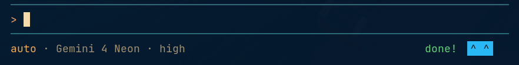
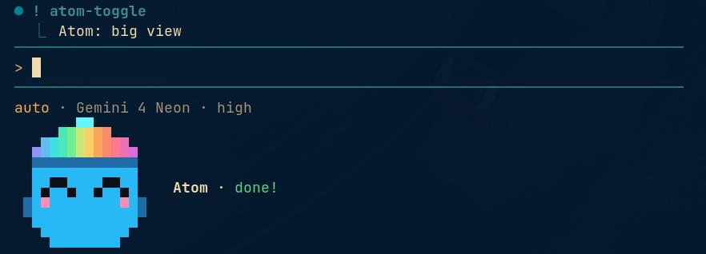

# Atom for Antigravity CLI

Atom also runs in **[Antigravity CLI](https://antigravity.google/docs/cli/statusline/) (`agy`)**.
It lives in the CLI's status line, right under the prompt, and reacts to what the agent is doing.
It's the same Atom with the same moods, in a terminal-sized form.



Atom has two views. Switch between them whenever you like:

| View | What you get |
|---|---|
| **Bar** (default) | One line. The CLI's own `auto · model · effort` info on the left and a small Atom face pinned to the end, e.g. `done! ^ ^`. Uses no extra space. |
| **Big** | The same info line with a pixel-art Atom V2 under it, about 7 lines tall. |



---

## Contents

- [Requirements](#requirements)
- [Install](#install)
- [Activate](#activate)
- [Switch between the bar and the big Atom](#switch-between-the-bar-and-the-big-atom)
- [What Atom shows](#what-atom-shows)
- [Skins and options](#skins-and-options)
- [Update](#update)
- [Turn off / uninstall](#turn-off--uninstall)
- [Troubleshooting](#troubleshooting)
- [How it works](#how-it-works)
- [Terms of Service and privacy](#terms-of-service-and-privacy)

---

## Requirements

- Antigravity CLI (`agy`). Run `agy --version` to check.
- Python 3.8 or newer, available as `python3` (on Windows, see [Windows](#windows)).
- A terminal with 24-bit colour for the big pixel Atom. Most modern terminals have it:
  foot, Kitty, Ghostty, WezTerm, Alacritty, GNOME Terminal, iTerm2, Windows Terminal.
  For others, see `--color 256` below.

Nothing else: no pip packages, no network access.

## Install

Atom has two parts: its **plugin** (the hooks that tell Atom what the agent is doing)
and its **status line** (what you see). Pick one of these:

### Option 1: Straight from GitHub (recommended)

```bash
agy plugin install https://github.com/Arnav8452/atom
python3 ~/.gemini/config/plugins/atom/atom_cli_setup.py
```

The first command uses `agy`'s own plugin installer. The second turns on Atom's status
line (see [Activate](#activate)).

### Option 2: From a git clone

```bash
git clone https://github.com/Arnav8452/atom.git
agy plugin install ./atom
python3 atom/atom_cli_setup.py
```

### Option 3: You already have desktop Atom

The desktop installer already put Atom's plugin in place, and the CLI shares it, so only
the status line is missing:

```bash
python3 ~/.gemini/config/plugins/atom/atom_cli_setup.py
```

> To check the plugin is installed, run `agy plugin list`. It should show
> `atom (enabled) · Components: 1 hook`.

## Activate

`atom_cli_setup.py` does three things:

1. Adds one block to `~/.gemini/antigravity-cli/settings.json`, using the CLI's
   [documented `statusLine` setting](https://antigravity.google/docs/cli/statusline/):

   ```json
   "statusLine": {
     "type": "command",
     "command": "python3 -S -I /path/to/atom/atom_status.py --style switch",
     "stack_with_default": false
   }
   ```

   Everything else in the file is left alone. If you already have a custom status line,
   setup stops instead of replacing it. Pass `--force` to replace it; your old one is saved and
   comes back when you uninstall.

2. Writes a tiny `atom-toggle` command to `~/.local/bin`, used for
   [switching views](#switch-between-the-bar-and-the-big-atom). It never overwrites
   another program with that name.

3. Tells you if the plugin is missing.

Then **quit `agy` and start it again.** Atom appears under the prompt as the one-line bar.

## Switch between the bar and the big Atom

Inside `agy`:

1. In the empty prompt, type **`!`** on its own. The `>` turns into a blue **`!`**,
   which means `agy`'s shell mode is on.
2. Type **`atom-toggle`** and press **Enter**.

Atom switches straight away, and `agy` prints `Atom: big view` or `Atom: bar view`.
Shell mode runs the command on your machine without involving the model, so it costs no
quota.

- The view is remembered across restarts. Atom starts as the bar and stays as whichever
  view you picked last.
- Typing or pasting `! atom-toggle` as a single line does **not** switch modes. `agy`
  sends that to the model as a normal prompt.
- You can also switch from any other terminal: `atom-toggle`, or
  `python3 /path/to/atom/atom_status.py --view big` (or `--view bar`). The change shows the
  next time `agy` redraws its status line.
- Why not click to switch? A status line can't receive mouse clicks; it only gets the
  CLI's state.

## What Atom shows

| When | Bar | Big view |
|---|---|---|
| Waiting for you | `ready ■ ■` | eyes forward |
| Thinking / reviewing | `thinking… ▀ ▀` | eyes up |
| Writing or editing code | `writing code… ▄ ▄` | eyes down |
| Running a command | `running a command… ■` | eyes to the side |
| Reading and searching files | `looking around…` | eyes to the other side |
| Subagents working | `2 subagents running · delegating…` | eyes to the side |
| **Needs your approval** for a tool | `needs your OK ◼ ◼` | wide eyes, yellow beanie, sweat drop |
| The agent asks you a question | `has a question` | wide eyes, yellow beanie |
| Turn finished | `done! ^ ^` | happy eyes and a blush |
| Turn ended in an error / you stopped it / step limit | `hit an error × ×` / `stopped` / `hit the step limit` | X eyes / closed / sleepy |
| You said thanks | blushes for that turn | blushes |
| You were rude or angry | angry eyes, red tint for that turn | angry brows, red body |
| You were hurtful | sad eyes, muted grey for that turn | sad eyes and a tear |
| Out of quota (every enabled quota bucket used, or the model hit its limit) | `out of quota · zzz · back at 14:30` | asleep, dimmed |
| Background tasks still running | `1 background task · keeping watch…` | eyes to the side |
| CLI starting up or signing in | `waking up…` | sleepy eyes |

Reactions like *done!* stay until your next prompt. The status line only redraws when
the agent's state changes, so Atom switches poses rather than animating between them.

## Skins and options

Pass these to `atom_cli_setup.py`. It writes them into the status line command, so run it
again to change them.

| Option | |
|---|---|
| `--skin v2` | **Atom V2** (default): round, leg-free blob with a rainbow beanie and pom-pom |
| `--skin atom` | the classic box Atom with a rainbow crown |
| `--skin chibi` | **Cozy Chibi**: cat-ear beanie, white hair, cream hoodie |
| `--skin base-qt` | **base qt.**: the original legless box |
| `--style switch` | (default) bar or big, switched with `atom-toggle` |
| `--style bar` / `--style big` | always the bar / always the big view |
| `--style sprite` | the pixel Atom **under** the CLI's normal status line (keeps the CLI's own tips and timers) |
| `--style line` / `--style auto` | stacked one-line Atom / pixel or one line depending on terminal width |
| `--color 256` | for terminals without 24-bit colour (`ATOM_COLOR=256` also works) |
| `--color none` | no colour; `NO_COLOR` is honoured too |
| `--python CMD` | the Python to run, e.g. `--python py` on Windows |
| `--bin DIR` | where to put `atom-toggle` (default `~/.local/bin`) |
| `--force` | replace a custom status line you already have (it's saved for uninstall) |
| `--dry-run` | show what would be written, change nothing |

See every skin or state without starting `agy`:

```bash
python3 atom_status.py --demo --skin all    # every skin
python3 atom_status.py --demo               # every state of the current skin
python3 atom_status.py --demo --style bar   # the same, as the bar
```

The terminal skins are small hand-drawn versions of the desktop skins in `assets/`, with
the same ids. Moods recolour only the blue body and leave the beanie stripes alone, as on
the desktop.

**Bar vs. the CLI's own line:** the bar replaces the CLI's status line and redraws its
mode, agent, model and effort. The CLI's other extras on that line (thinking timers, tips,
quota warnings) don't show while the bar is in use. If you'd rather keep them, use
`--style sprite` or `--style line`.

## Update

- **Option 1 (GitHub):** run `agy plugin install https://github.com/Arnav8452/atom` again,
  then `python3 ~/.gemini/config/plugins/atom/atom_cli_setup.py`.
- **Option 2 (clone):** `git pull` in your clone, then `agy plugin install ./atom` and
  `python3 atom/atom_cli_setup.py`.
- **Option 3 (desktop):** update desktop Atom as usual; the CLI uses the same files.

Re-running setup is always safe. It only refreshes Atom's own block, and keeps your
`padding` / `enabled` tweaks.

## Turn off / uninstall

```bash
python3 /path/to/atom/atom_cli_setup.py --uninstall   # status line + atom-toggle
agy plugin uninstall atom                             # the hooks (skip if you use desktop Atom)
```

`--uninstall` removes only Atom's status line, putting back the one Atom replaced if
there was one, and removes `atom-toggle`. To hide Atom for a while without uninstalling,
type `/statusline disable` in `agy` (`/statusline enable` brings it back).

## Troubleshooting

| Problem | Fix |
|---|---|
| Atom doesn't appear | Quit and restart `agy`. Check `settings.json` has the `statusLine` block. Run `/statusline enable`. |
| `⚠ Statusline disabled after 30 consecutive failures` | Make sure `python3` runs in your shell and the path in the command exists (did you move or delete the folder?). Re-run setup, then `/statusline enable`. |
| `atom-toggle` went to the model | Type `!` on its own first, so the prompt turns into a blue `!`, then `atom-toggle`. |
| `atom-toggle: command not found` | `~/.local/bin` isn't on your `PATH`. Setup prints the full command to use instead, or re-run it with `--bin` pointing at a folder that is on your `PATH`. |
| Colours look wrong or blocky | Re-run setup with `--color 256`. |
| Atom always says *thinking…*, never *running a command…* | The hooks aren't firing. Check `agy plugin list` shows `atom` enabled. |
| The bar wraps onto two lines | Your terminal is narrower than the line. Atom drops detail text and shortens the model name first; below about 30 columns, widen the window. |

Check what Atom is reading:

```bash
ls ~/.antigravity-atom/convs ~/.antigravity-atom/cli
echo '{"agent_state":"working","terminal_width":100}' | python3 atom_status.py --style bar
```

## How it works

```
agy ──plugin hooks──▶ atom_hook.py ──▶ ~/.antigravity-atom/{convs,emotion,limits}.json
 │                                                     │
 └──statusLine (JSON on stdin)──▶ atom_status.py ◀─────┘ ──▶ the status line text
                                       ▲
                     atom-toggle ──▶ ~/.antigravity-atom/cli/view.json
```

- `agy` runs `atom_status.py` whenever the agent's state changes, at most once every
  300 ms. It sends the session state as JSON on stdin. Atom reads `agent_state`,
  `tool_confirmation_pending`, `subagents`, `task_count`, `quota`, `model`,
  `cycle_mode`, `agent`, `terminal_width` and `conversation_id`.
- For things that JSON doesn't say, it reads the files Atom's hooks already write (the same
  ones desktop Atom uses): which tool is running, your prompt's tone, how the turn ended,
  and quota errors.
- It writes only `~/.antigravity-atom/cli/<conversation>.json` (whether the last redraw
  was busy, plus the current reaction) and `cli/view.json` (bar or big).
- It always exits 0 and prints a plain `Atom` if anything goes wrong, because `agy` turns
  off a status line after 30 failures in a row. The CLI also stops any run after 5 s, so
  Atom gives up after 3 s.

### Windows

`agy` runs the status line with `cmd /c`, and setup quotes the path with double quotes.
If `python3` isn't on your `PATH`, run setup with `--python py` (or `--python python`).
`atom-toggle` isn't created on Windows. Setup prints the full command to type after `!`
instead.

## Terms of Service and privacy

The CLI version uses only features Antigravity documents for this purpose:

| Piece | Documented feature |
|---|---|
| `atom_hook.py` via `hooks.json` | [Plugin lifecycle hooks](https://antigravity.google/docs/plugins/) |
| `atom_status.py` | [CLI custom status line](https://antigravity.google/docs/cli/statusline/) |
| `atom-toggle` | `agy`'s own `!` shell mode, typed by you |

It never wraps, launches, patches or injects into `agy`, and never talks to the network.
The status line JSON includes your account email; Atom never stores or prints it, nor
your conversation title, paths or prompts. The tests check this.
(The desktop overlay, `atom_launch.py`, works differently and isn't used by the CLI.)
