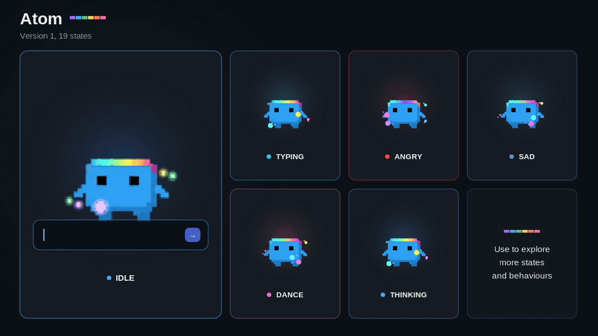

# Atom — a prompt-bar mascot for Antigravity

[](LICENSE)
[](https://github.com/Arnav8452/atom/actions/workflows/ci.yml)
[](https://github.com/Arnav8452/atom/actions/workflows/codeql.yml)




A tiny open-source pixel companion that stands on the prompt bar inside the
**Antigravity desktop app** and reacts in real time to what the agent is doing
— reasoning, editing code, running commands, exploring files, delegating
subagents, sleeping on quota limits, or reacting to your tone.

- **19 code-generated animated states:** every state (`idle`, `thinking`,
  `typing`, `working`, `exploring`, `running`, `delegating`, `asking`,
  `listening`, `watching`, `closed`, `dance`, `done`, `happy`, `sad`, `angry`,
  `error`, `canceled`, `tired`) is rendered programmatically onto transparent
  32-bit RGBA sprite sheets (`150×120` lossless WebP) sharing `base.gif`'s
  clean pixel silhouette and scrolling Gemini rainbow beanie.
- **Silky transitions without stutter:** switches use direct `requestAnimationFrame`
  60fps `140 ms` crossfades (no fast-forward rushing), while busy work states
  stay visible for at least `1.2 s` so rapid tool steps don't flicker past.
- **Sustained turn moods (`angry` & `sad`):** insults, profanity, or
  all-caps frustration tint Atom red (or muted blue for sadness) with tilted
  `\ /` or `/ \` eyes across *every* working animation until the response
  completes.
- **Per-model quota sleep & instant wake-up:** goes to sleep (`closed` with rising
  `Zzz`) when the active model reaches its 5-hour or weekly quota limit, and
  wakes immediately when you switch to a model with available quota.
- **Click to dance:** click Atom's body anytime (when calm and awake) to trigger
  its groovy `dance` animation (`Alt+click` switches between the left and right
  sides of the prompt bar; `Shift+click` switches skins if more than one
  folder exists under `assets/`).
- **Size follows the bar:** scales to 9% of the prompt bar's width (72–132 px)
  and tracks sidebar collapse/resize transitions automatically.

## How it works

```
Antigravity agent ──hooks.json──▶ atom_hook.py ──▶ ~/.antigravity-atom/*.json
                                                          │
atom_launch.py ──starts──▶ Antigravity app                ▼
      └── DevTools CDP ──▶ main window: atom_inject.js ◀─ state + mood + limits
```

- **Hooks** (`plugin.json` + `hooks.json`, an Antigravity plugin): runs
  `python3 -S -I ./atom_hook.py <Event>` on all 6 lifecycle events (`SessionStart`,
  `PreInvocation`, `PreToolUse`, `PostToolUse`, `PostInvocation`, `Stop`),
  writes per-conversation state/mood/limit JSON, and wakes the launcher
  immediately via `notify.sock` (Linux/macOS) or loopback UDP `notify.port` (Windows).
- **In-app rendering:** `atom_launch.py` launches Antigravity with
  `--remote-debugging-pipe` on Linux/macOS (or loopback `--remote-debugging-port`
  over a stdlib WebSocket client on Windows), injects the lightweight (<35 KB)
  `atom_inject.js` bootstrap, and streams per-state sprites lazily via
  `__loadState` only into localhost pages that mount `[data-testid="agent-input-box"]`.

## Install & Download

**Runtime requirements:** Python 3 only (zero pip dependencies; `git` optional if downloading a release zip).

### For AI Agents (Quick Install)

If you are an AI coding agent installing Atom into a user's Antigravity setup, pick the row matching the host OS, run the command once, verify, and instruct the user to quit and reopen Antigravity:

| Platform | Single-step Install Command | Plugin Path Created | Launcher Created |
| -------- | --------------------------- | ------------------- | ---------------- |
| **Linux** | `curl -fsSL https://raw.githubusercontent.com/Arnav8452/atom/main/install.sh \| bash` | `~/.gemini/config/plugins/atom` | `~/.local/share/applications/antigravity.desktop` |
| **macOS** | `curl -fsSL https://raw.githubusercontent.com/Arnav8452/atom/main/install.sh \| bash` | `~/.gemini/config/plugins/atom` | `~/Applications/Antigravity (Atom).app` |
| **Windows** | `irm https://raw.githubusercontent.com/Arnav8452/atom/main/install.ps1 \| iex` | `%USERPROFILE%\.gemini\config\plugins\atom` | Start Menu & Desktop `.lnk` (`Antigravity (Atom)`) |

**Environment overrides:** `ATOM_REPO` (custom git remote), `ATOM_DIR` (install checkout path), `ATOM_HOME` (runtime state dir, default `~/.antigravity-atom`), `ANTIGRAVITY_BIN` (custom Antigravity executable; on Linux the launcher otherwise checks the usual install paths, `PATH`, other `antigravity*.desktop` launchers, and `Antigravity*/` folders extracted into `/opt`, `~/.local/share`, `~/Applications`, `~/Apps`, `~/Downloads`, `~` and similar), `ANTIGRAVITY_PLUGINS_DIR` (custom plugins dir).
**Post-install check:** confirm `hooks.json` exists inside the plugin path above, then quit Antigravity completely and launch via the newly installed entry (or `python3 atom_launch.py`). See [`AGENTS.md`](AGENTS.md) for full contributor & automation details.

---

### Option 1: One-line remote install (recommended)

**Linux & macOS:**

```bash
curl -fsSL https://raw.githubusercontent.com/Arnav8452/atom/main/install.sh | bash
```

**Windows (PowerShell):**

```powershell
irm https://raw.githubusercontent.com/Arnav8452/atom/main/install.ps1 | iex
```

*(Prefer to inspect before running? Download `install.sh` / `install.ps1`, review it, then execute `./install.sh` or `.\install.ps1`.)*

### Option 2: Git clone & local install

```bash
git clone https://github.com/Arnav8452/atom.git atom && cd atom
./install.sh          # Linux / macOS
```

```powershell
git clone https://github.com/Arnav8452/atom.git atom; cd atom
.\install.ps1         # Windows PowerShell
```

### Option 3: Direct ZIP download (no Git required)

1. Download the repository archive:
   `https://github.com/Arnav8452/atom/archive/refs/heads/main.zip`
2. Extract it to a permanent folder (e.g. `~/.local/share/antigravity-atom` or `%LOCALAPPDATA%\antigravity-atom`).
3. Run `./install.sh` (Linux/macOS) or `.\install.ps1` (Windows) inside the extracted folder.

### Option 4: Zero-install portable run

From any clone or extracted archive, run the launcher directly — `atom_launch.py` automatically links/copies the hooks plugin into `~/.gemini/config/plugins/atom` on first start:

```bash
python3 atom_launch.py
```

### Option 5: Native OS Package Manifests (`packaging/`)

Ready-to-use manifests live under [`packaging/`](packaging):

- **Arch Linux (`makepkg` / AUR):** [`packaging/aur/PKGBUILD`](packaging/aur/PKGBUILD) (`antigravity-atom-git`)
  ```bash
  cd packaging/aur && makepkg -si && atom-setup
  ```
- **macOS (Homebrew formula):** [`packaging/homebrew/antigravity-atom.rb`](packaging/homebrew/antigravity-atom.rb)
  ```bash
  brew install --HEAD ./packaging/homebrew/antigravity-atom.rb
  "$(brew --prefix)/opt/antigravity-atom/libexec/install.sh"
  ```
- **Windows (Scoop manifest):** [`packaging/scoop/antigravity-atom.json`](packaging/scoop/antigravity-atom.json)
  ```powershell
  scoop install .\packaging\scoop\antigravity-atom.json
  ```
- **Windows (Winget manifest):** [`packaging/winget/Arnav8452.AntigravityAtom.yaml`](packaging/winget/Arnav8452.AntigravityAtom.yaml)

### Updating & Uninstalling

- **Update:** re-run the one-line installer, or run `git pull` inside your clone.
- **Uninstall (Linux/macOS):** `./install.sh --uninstall`
- **Uninstall (Windows):** `.\install.ps1 -Uninstall`
- Quit Antigravity completely and reopen it through the installed launcher/shortcut to meet Atom. (If Antigravity is already running, launching again forwards arguments to the existing single instance.)

### Antigravity CLI (`agy`)

Atom also works in Antigravity CLI as a custom status line, using only the CLI's documented hooks and `statusLine` setting: `python3 atom_cli_setup.py`. See [CLI.md](CLI.md).

## States (19 code-generated states)

| State        | Type       | When                                                            | Art                                                |
| ------------ | ---------- | --------------------------------------------------------------- | -------------------------------------------------- |
| `idle`       | Base       | `SessionStart`, `Stop` (fidgets once after 7 s idle)            | hover + thin beanie + organic coloured electrons   |
| `thinking`   | Base       | `PreInvocation` (model reasoning)                               | sky-blue + tucked legs + calm orbits & beanie shimmer|
| `typing`     | Base       | `PreToolUse` for `write_file` / `edit_file` / patches / delete  | sustained open laptop + overhead loading wave      |
| `working`    | Base       | `PostToolUse`, `PostInvocation`, other active tools             | spinning pixel gears + focused eyes                |
| `exploring`  | Base       | `PreToolUse` for `read_file` / `grep` / `search_web` / browser  | pixel document + sweeping cyan scan bar            |
| `running`    | Base       | `PreToolUse` for `run_command` / `bash` / `terminal`            | dark pixel terminal with scrolling emerald lines   |
| `delegating` | Base       | `PreToolUse` for `invoke_subagent` / `swarm` / `run_workflow`   | 3 orbiting mini-Atom buddies with link dots        |
| `asking`     | Base       | `PreToolUse` for `ask_question`                                 | speech bubble with pulsing `?` glyph               |
| `listening`  | Client     | User actively typing in the prompt box (while `idle`/`closed`)  | downward attentive gaze toward the prompt bar      |
| `watching`   | Base       | `Stop` with `fullyIdle: false` (background tasks still active)  | sweeping eyes + pulsing radar ping                 |
| `closed`     | Base       | No activity for 5 min, or active model reached its 5-hour / weekly quota limit (wakes immediately on switching to an available model) | sleepy dim blue body + closed eyes + rising `Zzz`  |
| `dance`      | Reaction   | Click Atom's body                                               | bouncy side-to-side groove, blinks & music notes   |
| `done`       | Reaction   | `Stop` (`NO_TOOL_CALL`) completing a busy turn                  | victory hop + `^ ^` eyes + pixel confetti          |
| `happy`      | Reaction   | Praise ("thanks", "perfect!", "nice work")                      | bright cyan glow + bouncy hop + rising hearts      |
| `sad`        | Turn mood  | Insults ("idiot", "useless", "stupid", "worthless", ...)        | muted blue tint + tilted `/ \` eyes across active states until reply ends |
| `angry`      | Turn mood  | Abuse/frustration ("wtf", "fuck u", "shut up", ALL CAPS, ...)   | red tint + tilted `\ /` eyes across active states until reply ends        |
| `error`      | Reaction   | `PostToolUse` with `error` or `Stop` (`ERROR`)                  | startled jolt + `X X` eyes + flashing `!` badge    |
| `canceled`   | Reaction   | `Stop` (`USER_CANCELED`)                                        | wide `O O` surprised eyes + muted electrons        |
| `tired`      | Reaction   | `Stop` (`MAX_INVOCATIONS` / token limit)                        | heavy droop + half-lidded eyes + sweat drop        |

### How to trigger reactions & test states

- **On screen:** click Atom's body to make it **dance** (`Alt+click` toggles between the left and right sides of the prompt bar; `Shift+click` switches skins if more than one is installed; clicking does not dance while `angry`, `sad`, or sleeping from a quota limit).
- **In chat:**
  - `angry`: send curses, hostility, or frustration like `"wtf"`, `"fuck u"`, `"shut up"`, `"stfu"`, `"still broken"`, or an ALL-CAPS sentence like `"WHY IS THIS NOT WORKING"`. Atom heats up to red with tilted `\ /` eyes across every active work animation (`thinking`, `exploring`, `typing`, `running`, `working`, etc.) until the response finishes, then cools back to blue.
  - `sad`: send insults like `"idiot"`, `"useless"`, `"worthless"`, `"stupid"`, `"you're garbage"`, `"this code is trash"`, or `"you suck"`. Atom shifts to a muted blue tint with tilted `/ \` eyes across all work animations until the response finishes, then warms back up.
  - `happy`: send thanks/praise like `"thanks!"`, `"perfect!"`, or `"nice work"`.
- **Live preview CLI & gallery** (triggers any state/mood live, or views all 19 × 3 combinations in your browser):

```bash
python3 tools/trigger_state.py --gallery              # interactive grid of all 19 states x Normal/Angry/Sad
python3 tools/trigger_state.py typing --mood angry    # live angry-tinted + tilted-eye typing
python3 tools/trigger_state.py thinking --mood sad    # live sad-tinted + tilted-eye thinking
python3 tools/trigger_state.py --tour --mood angry    # cycle work states in angry mood
python3 tools/trigger_state.py --tour-all             # cycle normal, angry work, and sad work states
python3 tools/trigger_state.py --limit gemini-3-pro   # simulate 5h/weekly quota sleep
python3 tools/trigger_state.py --clear-limit gemini-3-pro
```

- **Smooth transitions & dwell time.** Switches finish the current frame cleanly
  and crossfade at 60fps over `140 ms` without fast-forwarding. Busy states
  stay on screen for at least `1.2 s` before switching so rapid tool steps
  remain easy to spot.
- **Reactions vs. turn moods.** One-shot reactions (`dance` / `happy` / `done` /
  `error` / `canceled` / `tired`) play once at natural speed and return to the
  agent's state. Turn moods (`angry` / `sad`) tint Atom's body and tilt its eyes
  across every active working state for that message, suppress dancing while
  active, and smoothly cool/recover on `Stop`.
- **What counts as an emotion:** they come from your message (`lastUserInput`
  on the first model call of a turn). Code in backticks, URLs, and paths are
  ignored, common technical phrases (e.g., "garbage collector", "worst-case",
  SQL queries) are filtered out, and words like "amazing" only count in short
  replies.
- **Fallback art:** states without their own art reuse the idle animation
  lazily on first use, with only the blue body pixels recoloured and a
  different speed (`FALLBACK_LOOK` in `atom_inject.js`). Everything stays fully
  opaque; recolouring yields cleanly so the app never stalls.

## Adding art

Sprites are frame grids, `assets/<skin>/<state>.webp` (150×120 per frame,
lossless), with `<state>.json` for the timings and optional `"loop": [start, end]`
segment bounds. `./tools/build_assets.sh` runs `tools/render_all.py` to
programmatically regenerate all 19 states directly onto
transparent RGBA sheets from `art/base.gif` and `art/gemini.gif`. To add custom art for
a state or second skin:

```bash
uv run --with pillow tools/make_sprite.py sad_render.gif atom sad --center-x 417
```

A second folder under `assets/` becomes a second skin; with more than one,
`Shift+click` on Atom's body switches between them.

`--center-x` is the x of the body's centre in the render; feet are assumed at
y≈222, so every state lines up. If a haze shows around the sprite, raise
`--floor` (`thinking` uses `--floor 44`). Restart the app to pick up new art.

## Security & Privacy

- **Zero network / telemetry:** Atom never opens outbound sockets or sends data off your machine.
- **Localhost-only injection:** `atom_launch.py` attaches only to `http(s)://127.0.0.1:<port>/` or `http(s)://localhost:<port>/` targets and uses DevTools pipes (no TCP port) on Linux/macOS or loopback-only WebSocket on Windows.
- **User-private state & sockets:** runtime state files and UNIX wakeup sockets in `~/.antigravity-atom` use owner-only permissions (`0700` dirs, `0600` socket on POSIX) and never persist raw user prompts.
- **Isolated hooks:** `atom_hook.py` runs under `python3 -S -I` with empty stdout on `PreToolUse` so Antigravity's own permission controls remain untouched.
- See [SECURITY.md](SECURITY.md) for reporting vulnerabilities privately via GitHub Security Advisories.

## Contributing & Community

Contributions, bug reports, new animations, and extra skins are welcome!

- Read [CONTRIBUTING.md](CONTRIBUTING.md) and [AGENTS.md](AGENTS.md) before opening a pull request.
- Open a [Bug Report](https://github.com/Arnav8452/atom/issues/new?template=bug_report.yml) or [Feature Request](https://github.com/Arnav8452/atom/issues/new?template=feature_request.yml).
- Participation is governed by our [Code of Conduct](CODE_OF_CONDUCT.md).

## Tests

```bash
python3 -m unittest discover -s tests -v
node --test tests/test_atom_inject.mjs
```

## Project Layout

```
plugin.json, hooks.json         Antigravity plugin manifest & lifecycle hooks
atom_hook.py                    hook -> state/mood/limit files (stdlib, ~20 ms per event)
atom_launch.py                  cross-platform launcher & CDP injector (Linux/macOS/Windows)
atom_inject.js                  in-app mascot renderer, 60fps crossfades, mood & limit sync
assets/atom/                    19 lossless WebP sprite sheets + frame/loop JSON metadata
assets/moodboard.{gif,webp}     animated 16:9 showcase card
tools/render_all.py             code-generated renderer for all 19 states
tools/render_gemini_typing.py   base silhouette extractor & rainbow crown sampler
tools/render_idle.py            standalone idle GIF/RGBA renderer
tools/render_moodboard.py       animated mood board builder (GIF + WebP)
tools/trigger_state.py          live preview CLI + local --gallery server
tools/preview.html              interactive browser gallery (19 states × Normal/Angry/Sad)
tools/make_sprite.py            custom render -> sprite sheet helper (optional Pillow)
tools/build_assets.sh           rebuild all 19 sprite sheets
art/                            original source artwork and reference renders
packaging/                      AUR PKGBUILD, Homebrew formula, Scoop & Winget manifests
tests/                          Python & Node.js unit test suite + GitHub Actions CI & CodeQL
.github/                        CI, CodeQL security scanning, Dependabot, CODEOWNERS & templates
install.sh, install.ps1         Linux/macOS (.app bundle) & Windows remote/local installers
AGENTS.md, CONTRIBUTING.md      contributor, AI-agent, governance & security documentation
SECURITY.md, CODE_OF_CONDUCT.md security policy & Contributor Covenant v2.1
LICENSE                         MIT License
```

## Notes

- Licensed under the **MIT License** — see [LICENSE](LICENSE).
- `PreToolUse` prints nothing, so Antigravity's own permission settings still
  decide whether a tool runs.
- Placement relies on the app's `data-testid="agent-input-box"`. If an app
  update renames it, Atom just doesn't appear; the app itself is unaffected.
